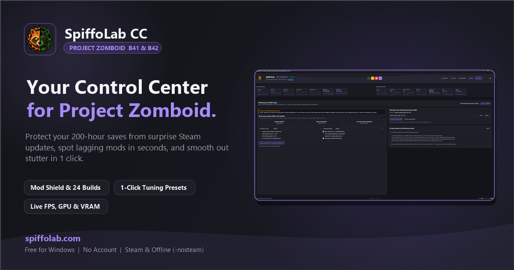
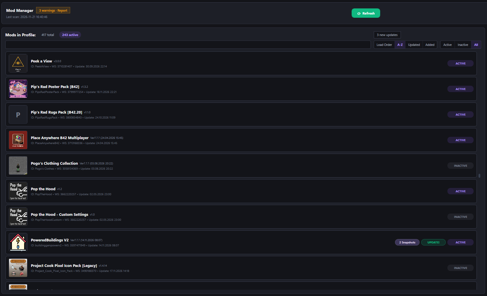
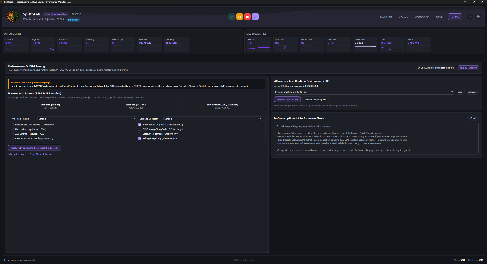
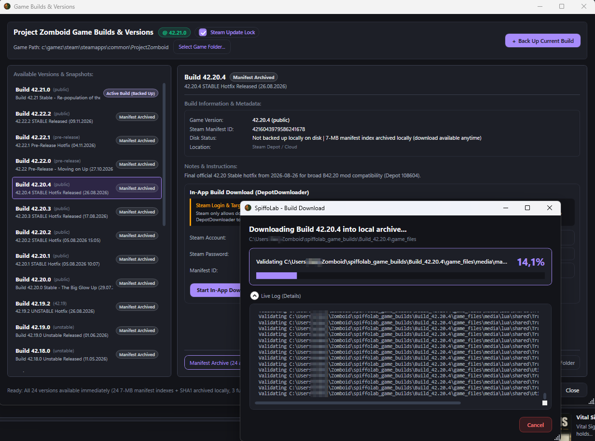

  

# SpiffoLab CC — Your Control Center for Project Zomboid (B41 & B42)

**Official Distribution, Release & Issue Tracker Repository**  
**Website:** [spiffolab.com](https://spiffolab.com) | **Steam Workshop:** [SpiffoLab CC](https://steamcommunity.com/sharedfiles/filedetails/?id=3842584609) | **[Changelog](CHANGELOG.md)** | **[Roadmap](ROADMAP.md)**  
**Author:** Haf Hunter | **License:** Proprietary Freeware (All Rights Reserved — see [`LICENSE.txt`](LICENSE.txt))

---

## Quick Download & First-Time Installation (Windows)

1. **Download the Windows Installer:**  
   [**Download SpiffoLab-Setup.exe**](https://github.com/haf-hunter/SpiffoLab/releases/download/v2.5.2/SpiffoLab-Setup.exe)
2. **Run `SpiffoLab-Setup.exe` once** and follow the guided Setup Wizard (no admin rights and no extra runtimes required — everything is included).
3. **Automatic Future Updates:**  
   When you launch SpiffoLab CC, it automatically checks for new releases and updates itself in one click.  
   **Note:** You never need to download `.slupd` files manually — `.slupd` packages are signed, encrypted update files used automatically by SpiffoLab's built-in updater.

### Security & Verification
- **Public VirusTotal Scan (`SpiffoLab-Setup.exe`):** [View VirusTotal Report](https://www.virustotal.com/gui/file/2bbc4be8d7c8dc1f27738207eba27e11293b7ec954ac17347c8bf36b4db0ba2b?nocache=1)
- **SHA-256:** `2bbc4be8d7c8dc1f27738207eba27e11293b7ec954ac17347c8bf36b4db0ba2b`
- **Windows SmartScreen Note:** SpiffoLab is a free indie tool without a corporate certificate. If SmartScreen shows *"Unknown publisher"*, click **More info -> Run anyway**.

---

## Screenshots

| Mod Manager, Profiles & Workshop Discovery | 1-Click Performance Tuning & Live GPU / VRAM |
| :---: | :---: |
|  |  |

| Real-Time Mod Performance Dashboard | 24 Game Builds (B19–B42) & In-App Downloader |
| :---: | :---: |
|  |  |

---

## What SpiffoLab CC Does

- **Save & Mod Shield:** Protects your subscribed Workshop mods locally so forced Steam updates never break a 200-hour save. Lock individual mods or update safely with automatic pre-update backups.
- **1-Click Profile Manager & 24 Game Builds (2013–2026):** Switch between Solo, Testing, and Multiplayer profiles in one click, download archived game versions directly in-app (from B42/B41 back to 2013 Build 19), and launch with or without Steam (`-nosteam`).
- **1-Click Performance Tuning:** Ready-made performance presets matched to your PC memory, plain-English graphics setting tips, easy Java switching, and automatic conflict warnings if you use other optimization tools.
- **Live Performance & 30-Second Benchmark:** Track real-time FPS (Avg, 1%, 0.1% Low), CPU, GPU load, dedicated VRAM, memory, and per-mod lag spikes — plus shareable reports for Discord or bug tracking.

---

## System Requirements
- **OS:** Windows 10 or Windows 11 (64-bit)
- **Runtime:** Self-contained — no extra runtimes required
- **Game:** Project Zomboid (Build 41 & Build 42)
- **Languages:** English, German, Spanish, and Portuguese

---

## Changelog & Roadmap
- **[Public Changelog](CHANGELOG.md):** Player-focused history of all major updates and fixes.
- **[Public Roadmap](ROADMAP.md):** Upcoming features and milestones currently in planning or development.

---

## Support & Bug Reports

Found a bug or have a feature request? Open an issue anytime in our [Issue Tracker](https://github.com/haf-hunter/SpiffoLab/issues).

**Copyright (c) 2026 Haf Hunter. All Rights Reserved.**
