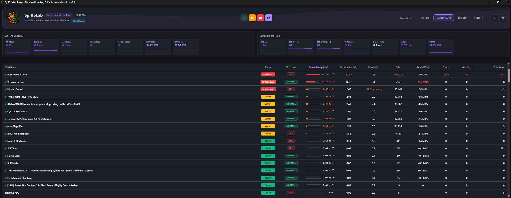

  

# SpiffoLab CC — Your Control Center for Project Zomboid (B41 & B42)

**All your mods, 24 game builds, and instant profile switching — powered by live benchmarks and analysis tools that expose FPS killers in seconds.**  
SpiffoLab CC puts your entire Project Zomboid setup under one roof: protect long-term saves from surprise Steam updates, jump between Solo, Testing, and Multiplayer profiles in one click, and pinpoint lagging or crashing mods instead of guessing.

**100% Free Windows Control Center** | **Self-Contained (No Extra Runtimes)** | **No Admin Rights**  
[**Try the Interactive Demo (spiffolab.com)**](https://spiffolab.com) · [**Download SpiffoLab-Setup.exe**](https://github.com/haf-hunter/SpiffoLab/releases/download/v2.5.2/SpiffoLab-Setup.exe) · [**Steam Workshop (B41 & B42)**](https://steamcommunity.com/sharedfiles/filedetails/?id=3843642618) · [**VirusTotal Verified**](https://www.virustotal.com/gui/file/2bbc4be8d7c8dc1f27738207eba27e11293b7ec954ac17347c8bf36b4db0ba2b?nocache=1) · [**Changelog**](CHANGELOG.md) · [**Roadmap**](ROADMAP.md)

---

## Why Players Switch to SpiffoLab CC

| Without SpiffoLab | With SpiffoLab CC |
| :--- | :--- |
| Steam updates overwrite mods or game builds mid-save | **Auto-Freeze & 1-Click Rollback** — sit out forced updates as long as you want |
| Digging through thousands of log lines after a crash | **Live Log & Instant Culprit Finder** — see which mod actually caused the crash |
| Guessing which mod is tanking your FPS or causing stutter | **Live GPU/VRAM Monitor, Dashboard & 1-Click Tuning** — spot heavy mods and smooth out stutter |
| Stuck with one setup and mandatory Steam client | **24 Game Builds, 1-Click Profiles & Offline Mode** — play any build (B19–42.22.2), even without Steam |

---

## Screenshots

| Mod Manager, Update Locks & Workshop Discovery | 24 Game Builds (B19–42.22.2) & In-App Downloader |
| :---: | :---: |
|  |  |

| 1-Click Performance Tuning & Live GPU / VRAM | Real-Time Mod Performance Dashboard |
| :---: | :---: |
|  |  |

*Want to explore every feature before installing? Try the live interactive preview directly in your browser at [spiffolab.com](https://spiffolab.com).*

---

## Everything in One Place

### 1. Protect Your Saves, Manage Mods & Play Any Build
- **Save & Mod Shield:** Automatically mirrors subscribed Workshop mods locally so surprise Steam updates never break a 200-hour save. Lock individual mods or update safely with automatic pre-update backups.
- **Play Any Build You Want (24 Builds, 2013–2026):** Stay on Build 42.22.2, roll back to 42.21, or jump back to Build 41 or original 2013 Build 19 right inside the app with a live progress bar — your add-ons stay protected automatically.
- **1-Click Profile Manager (Solo, Testing & Multiplayer):** Switch between completely isolated modpacks, saves, sandbox presets, and game builds in one click without manual folder copying.
- **Play With or Without Steam (`-nosteam`) & Workshop Discovery:** Launch via Steam or offline without Steam, and browse curated Build 42 Workshop picks right inside the launcher.

### 2. Tune Performance, Spot Lagging Mods & Fix Crashes
- **1-Click Performance Tuning (`TUNING` Tab):** Choose *Default (Off)*, *Balanced*, or *Low-Stutter* automatically matched to your PC memory, get plain-English graphics tips, switch Java versions per profile, and stay protected from conflicts with external optimizers.
- **Live Hardware Monitor (FPS, GPU & VRAM):** Track real-time FPS (Avg, 1% & 0.1% Low), CPU, real graphics card load, dedicated VRAM, memory, and Zombie AI — with clean automatic reset whenever the game closes.
- **Mod Performance Dashboard & Live Log:** Rank every active mod by frame cost, worst lag spike, and errors, and separate the true crash culprit from innocent follow-up errors in real time.
- **30-Second Benchmark & Shareable Report:** Run a guided 30-second in-game benchmark, see whether drops come from mods, Zombie AI, chunk loading, or collisions, and export clean reports for Discord or bug tracking.

---

## Quick Download & First-Time Setup (Windows)

1. **Download the Self-Contained Windows Installer:**  
   [**Download SpiffoLab-Setup.exe**](https://github.com/haf-hunter/SpiffoLab/releases/download/v2.5.2/SpiffoLab-Setup.exe)  
   Run it once and follow the guided Setup Wizard — **no admin rights and no extra runtimes required** (everything is bundled).
2. **Automatic Verified In-App Updates:**  
   When you launch SpiffoLab CC, it automatically checks for new releases and installs signed, encrypted `.slupd` updates in one click.  
   **Note:** You never need to download `.slupd` files manually — SpiffoLab's built-in updater handles them automatically.

### Security & Verification
- **Public VirusTotal Scan (`SpiffoLab-Setup.exe`):** [View VirusTotal Report](https://www.virustotal.com/gui/file/2bbc4be8d7c8dc1f27738207eba27e11293b7ec954ac17347c8bf36b4db0ba2b?nocache=1)
- **SHA-256:** `2bbc4be8d7c8dc1f27738207eba27e11293b7ec954ac17347c8bf36b4db0ba2b`
- **Windows SmartScreen Note:** SpiffoLab is a free indie tool without a corporate certificate. If SmartScreen shows *"Unknown publisher"*, click **More info -> Run anyway**.

---

## System Requirements & Links
- **OS:** Windows 10 or Windows 11 (64-bit)
- **Runtime:** Self-contained — no extra runtimes required
- **Game:** Project Zomboid (Build 41 & Build 42, plus archived builds back to Build 19)
- **Languages:** English, German, Spanish, and Portuguese
- **Changelog & Roadmap:** [Full Changelog (`v1.0.2` – latest)](CHANGELOG.md) | [Roadmap](ROADMAP.md)
- **Support & Bug Reports:** Open an issue anytime in our [Issue Tracker](https://github.com/haf-hunter/SpiffoLab/issues)

---

**Author:** Haf Hunter | **License:** Proprietary Freeware (All Rights Reserved — see [`LICENSE.txt`](LICENSE.txt))  
*SpiffoLab CC is an independent, unofficial fan-made utility and is not affiliated with, endorsed by, or associated with The Indie Stone. Project Zomboid is a registered trademark of The Indie Stone.*
